# ASCENT: Autonomous Battery Swap and Charging Station for Drones

> A ground station that lands, aligns, unloads, reloads and charges a drone's battery with **no human involved**.

[](https://youtu.be/bjAyfPhSSEc)

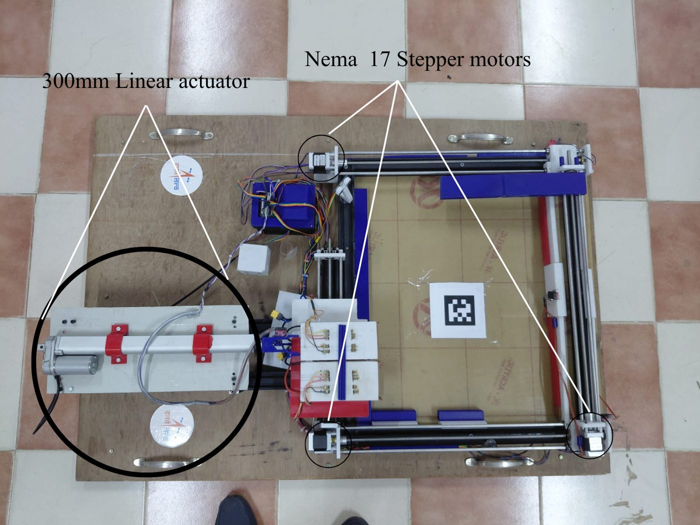

## The problem
Small multirotor drones fly only about 20 minutes per battery. Every battery change needs a person at the drone, which ends long missions and makes unattended operation (survey, inspection, search and rescue) impossible.

## The solution
ASCENT is a base station the drone lands on. It detects the drone, centres it mechanically, swaps the used battery for a charged one, and charges the used one for the next landing. It was built by **Team Orbital Bytes (Team ID 10732)** as the ground partner of our quadrotor (4S Li-ion, 14.8 V, 5600 mAh).

## How a swap works
| # | Step | What happens |
|---|------|--------------|
| 1 | Detect | HC-SR04 ultrasonic sensor reads the drone within **50 cm**, confirmed by 5 consecutive readings |
| 2 | Confirm | Station waits **3 s** |
| 3 | Align | X beams (two stepper motors) then the Y beam (one stepper) slide the drone against limit switches, so it always sits in the same place |
| 4 | Position | The Z-axis table (the battery swap station, one stepper) moves a cartridge in line with the drone's battery case |
| 5 | Swap | A **300 mm linear actuator** does all pushing and pulling. The servo only **locks (0°) and releases (90°)** the latch hook. Used battery goes into one cartridge and **charging starts as soon as it is seated**. The charged battery from the other cartridge is pushed into the drone |
| 6 | Verify and reset | Z check, then Y and X return home |
| 7 | Standby | **7 minutes** minimum before the next swap |

Each actuator stroke runs **25 s**; a swap uses six strokes (three extend/retract pairs).

## Hardware
| Part | Role |
|------|------|
| Arduino MEGA 2560 + CNC Shield V3 | Controller |
| 4x NEMA17 + A4988 drivers | X (2 motors), Y (1), Z (1) |
| 12 V 300 mm linear actuator + BTS7960 H-bridge | Pushes and pulls the battery (PWM 76/255, about 15 mm/s) |
| SG92R servo + latch hook | Locks / releases the battery |
| HC-SR04 | Drone detection |
| 6 limit switches (active-low, 8x300 µs debounce) | Alignment and axis end positions |
| Copper rails + pins | Charging connection; separate balance-lead pins |
| SkyRC D100neo charger | Charges the battery |
| TENET 12 V 200 W 16 A SMPS | Powers the station |

### Pin map
| Signal | Pin | Signal | Pin |
|---|---|---|---|
| X STEP / DIR | D2 / D5 | X HOME / X REV | A3 / D9 |
| Y STEP / DIR | D3 / D6 | Y FWD / Y REV | D24 / D25 |
| Z STEP / DIR | D4 / D7 | Z FWD / Z REV | D22 / D23 |
| Stepper ENABLE | D8 | Actuator RPWM / LPWM | D10 / D11 |
| Servo | A2 | Ultrasonic TRIG / ECHO | A0 / A1 |

## Mechanical design (CAD)
| | |
|---|---|
| 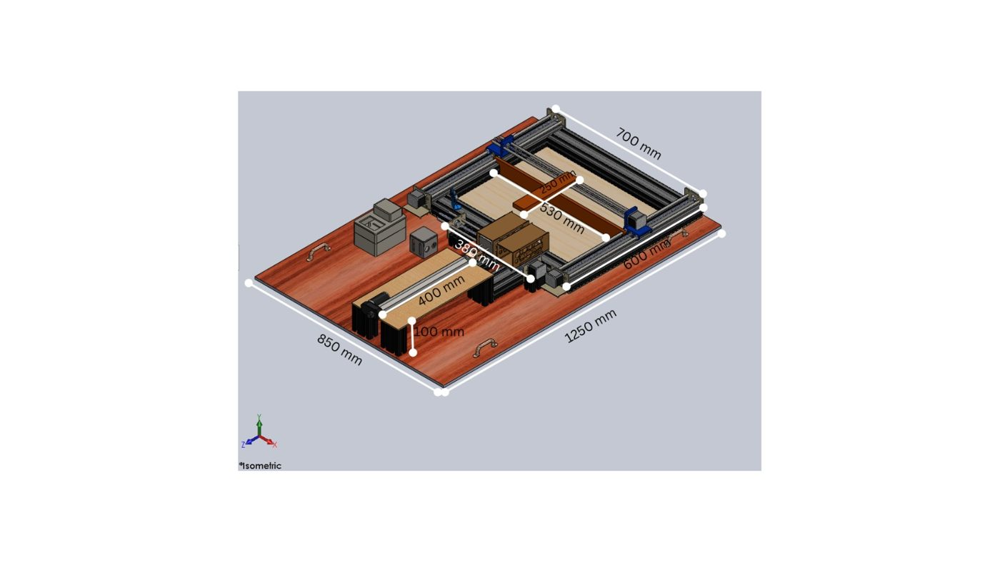 | 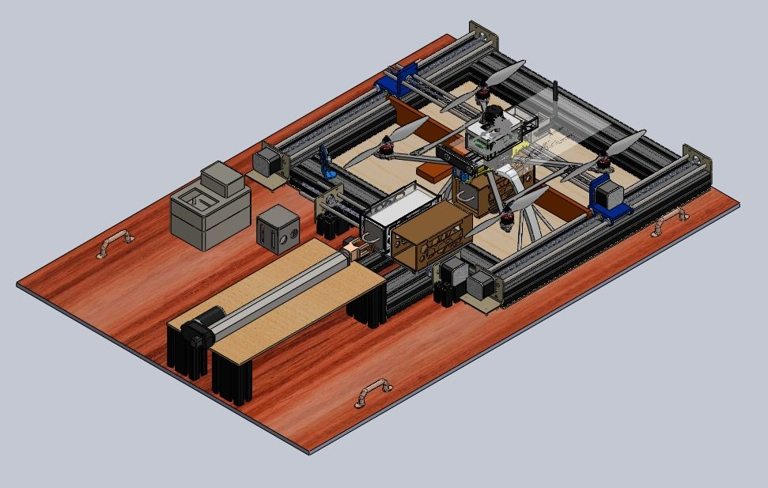 |
| Overall dimensions | Station with the drone on the pad |
| 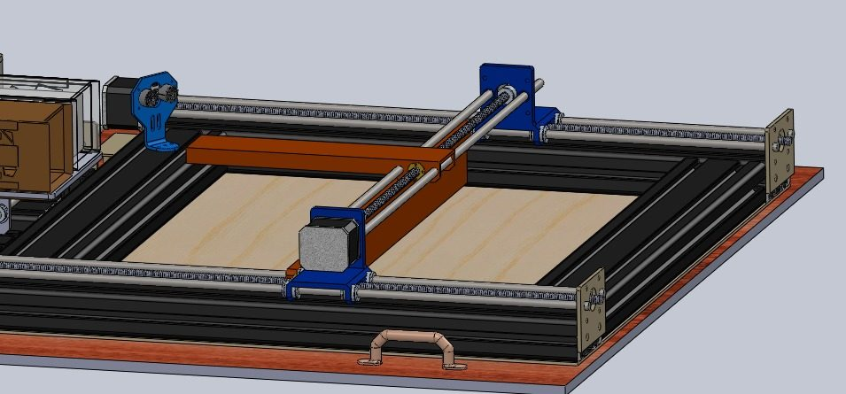 | 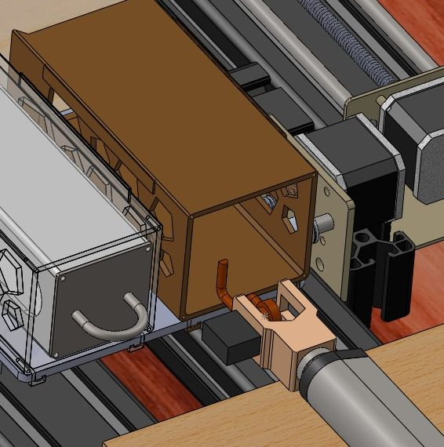 |
| X/Y gantry | Battery cartridge |

## Built station
**Alignment.** The ultrasonic sensor detects the landed drone; the slider moves it until it strikes the limit switch.

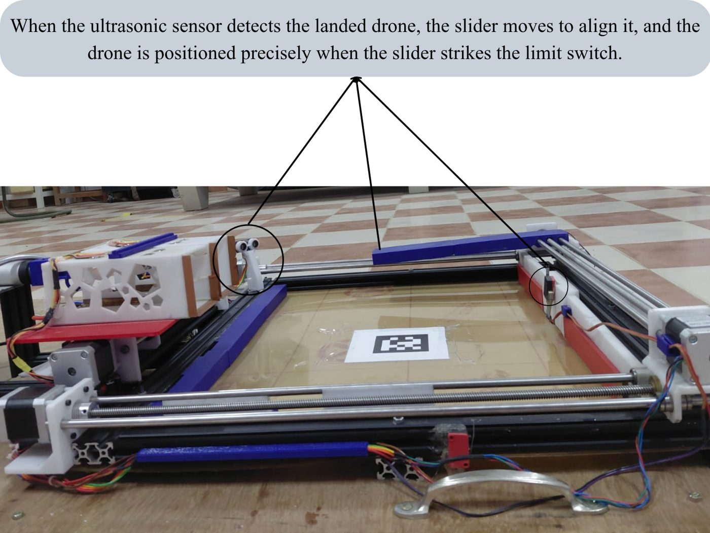

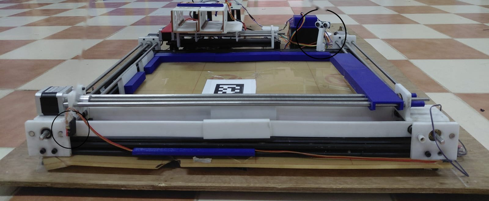
*Front view: the ultrasonic sensor (right) and the limit switch at the opposite corner (left).*

**Latch hook** (locked at 0°, released at 90°):

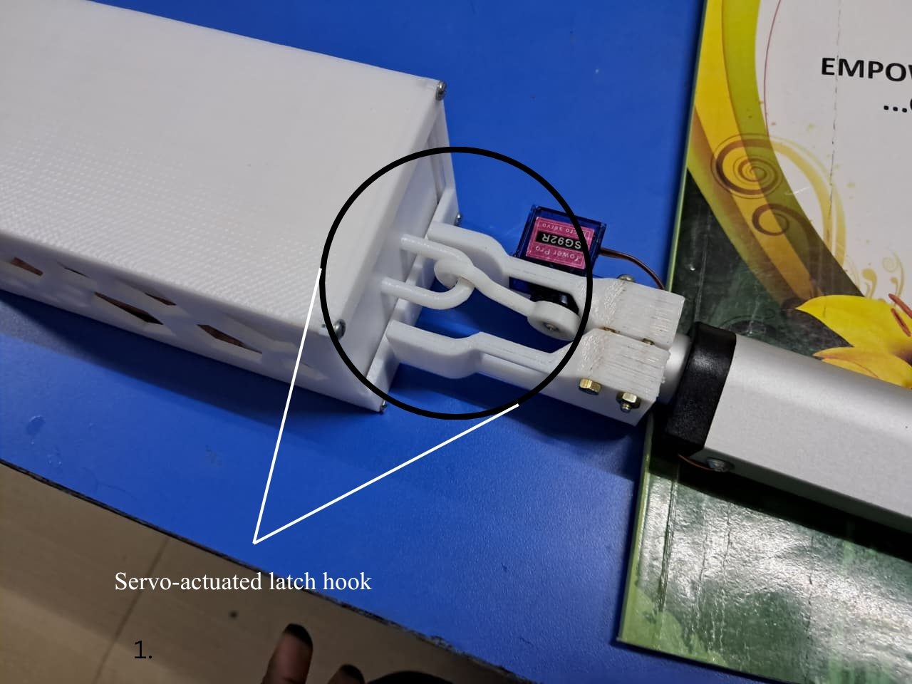

**Charging.** Pins connect to copper rails; balance pins are separate.

| | |
|---|---|
| 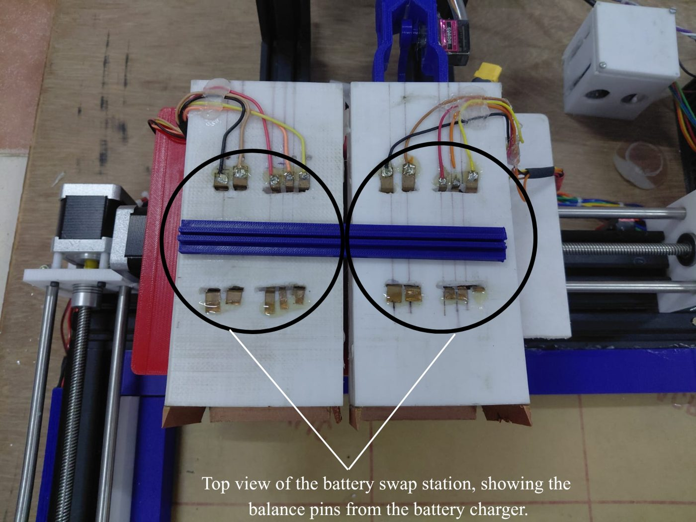 | 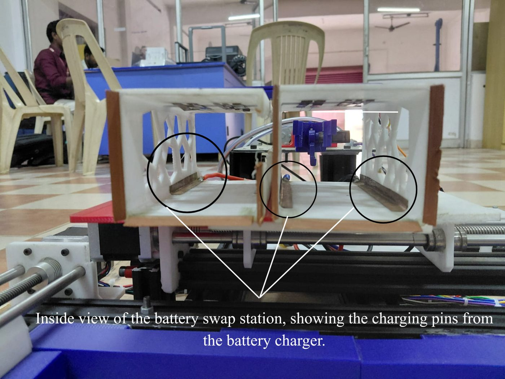 |
| Balance-charge pins (top view) | Charging pins and rails (inside view) |

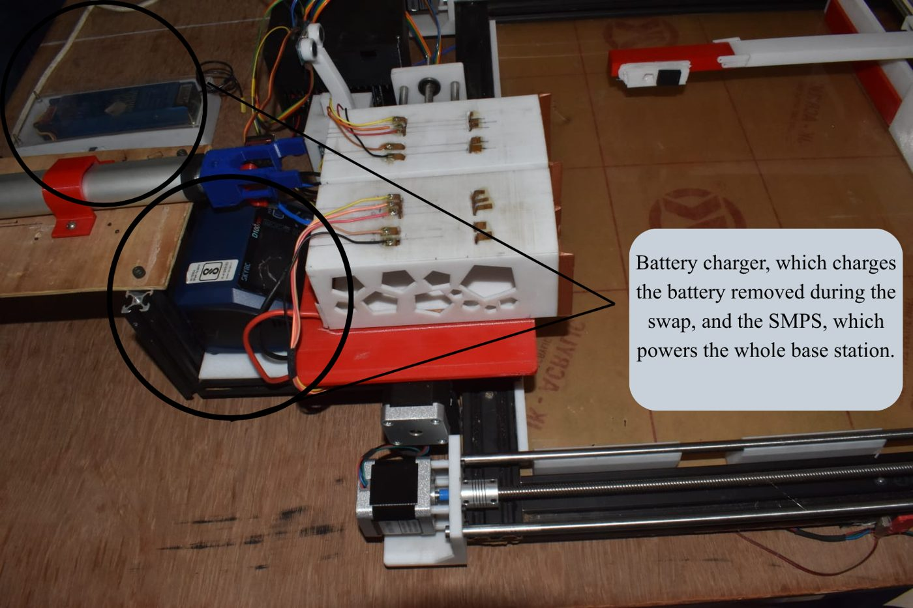
*SkyRC D100neo charger and the SMPS powering the station.*

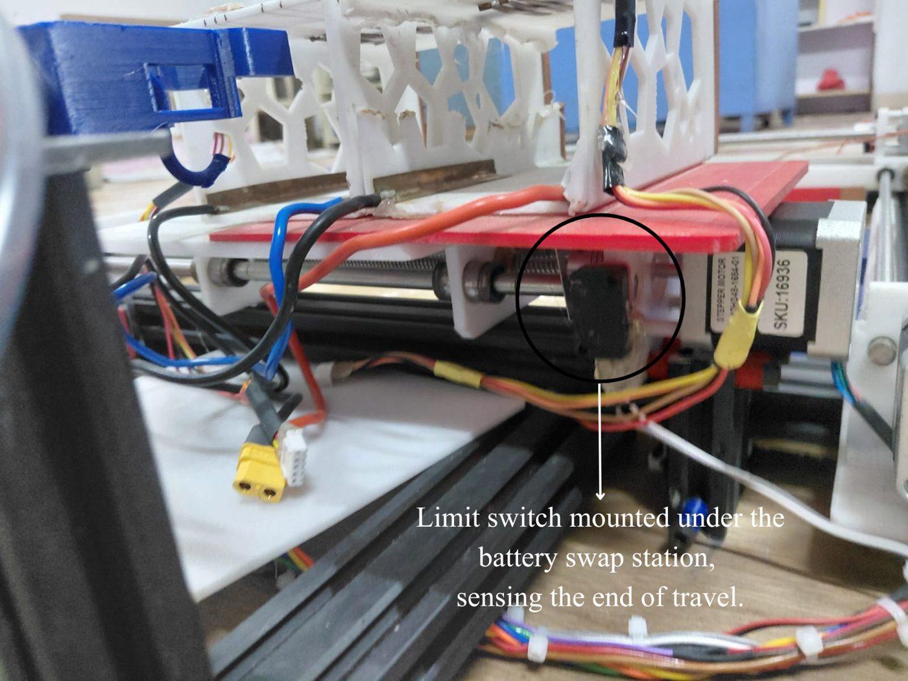
*Limit switch under the swap station.*

## Field test
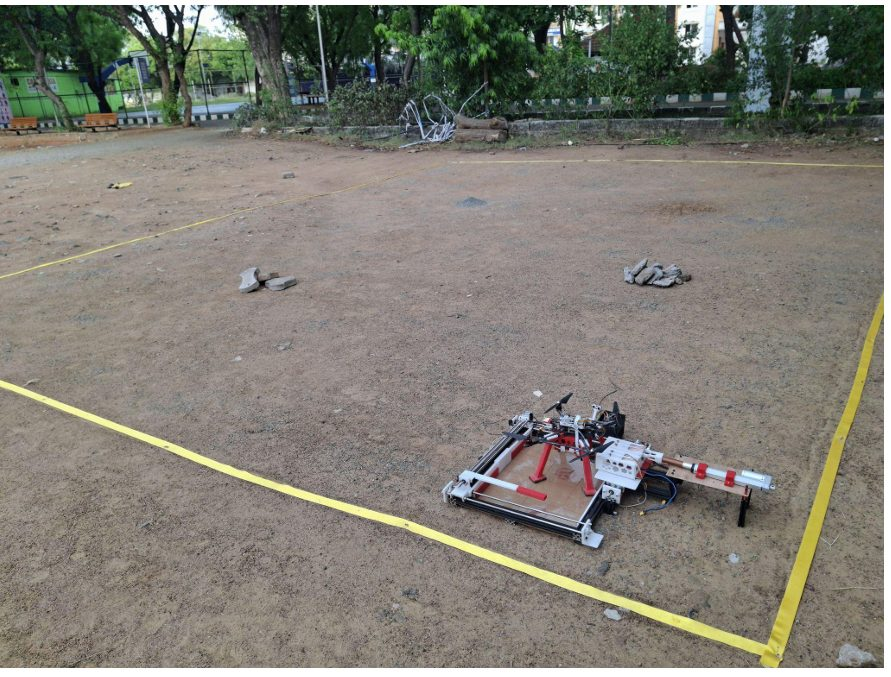

Demo video: https://youtu.be/bjAyfPhSSEc

## Firmware
[`firmware/ascent_swap/ascent_swap.ino`](firmware/ascent_swap/ascent_swap.ino): a non-blocking state machine (`micros()`/`millis()`), written for the Arduino IDE with the built-in `Servo` library.

1. Open the file, select **Arduino Mega 2560**, upload.
2. Open the Serial Monitor at **115200** baud.
3. Commands: `S` emergency stop, `SW` switch states, `D` read ultrasonic, `H` help.

Key constants (matching the Team 10732 pre-field report):
```cpp
#define DRONE_CM 50
#define ACT_PWM 76
#define SERVO_LOCKED_DEG 0
#define SERVO_RELEASED_DEG 90
const unsigned long ACT_STROKE_MS   = 25000;
const unsigned long CONFIRM_WAIT_MS = 3000;
const unsigned long MIN_SWAP_MS     = 420000UL; // 7 minutes
```

## Known limits and next steps
- A full landing-to-standby swap has not yet been timed with a stopwatch; this is the next test.
- The actuator is rated for a 20 % duty cycle. A swap runs it for 150 s, about 26 % averaged over the 7-minute standby, so actuator temperature needs checking over repeated swaps.
- Each 25 s stroke is longer than the roughly 20 s a 300 mm stroke takes at this speed, so the actuator relies on its own end stops.

## Team
Team Orbital Bytes (ID 10732), Francis Xavier Engineering College, Tirunelveli.
